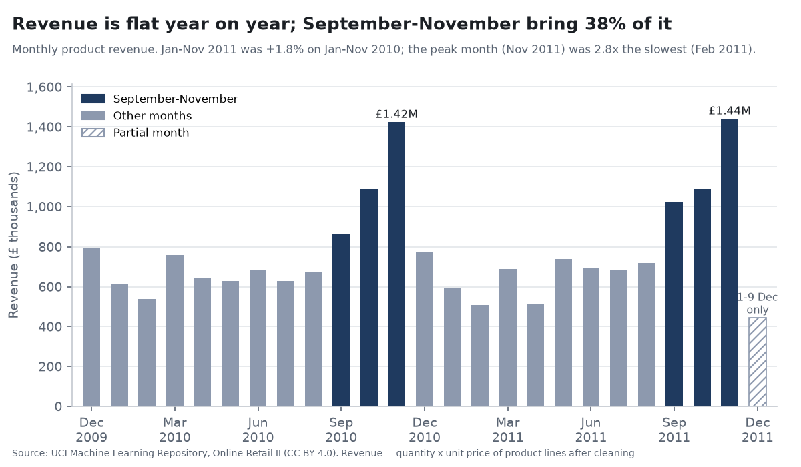
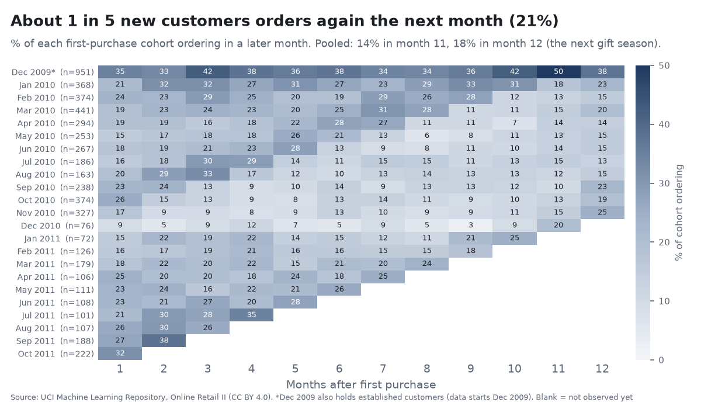
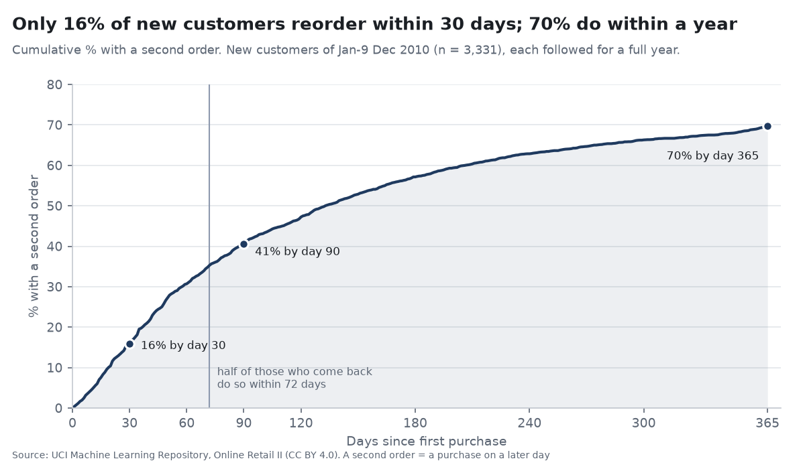
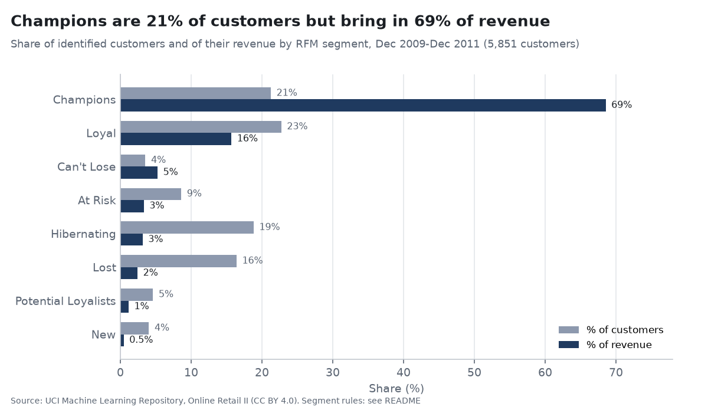
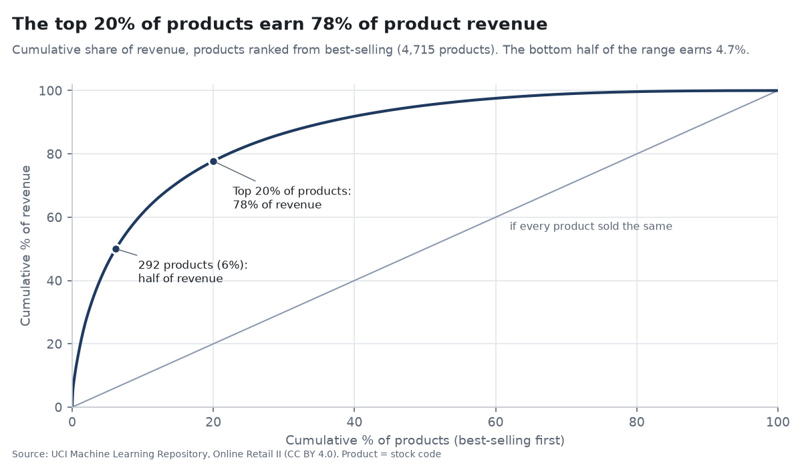
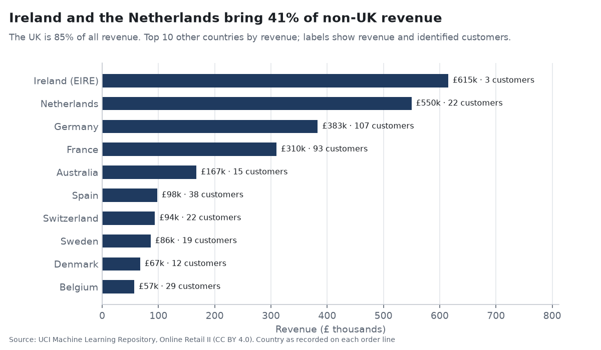

# E-commerce Customer Analytics: retention, RFM segments and an Excel report

**Who are a UK online gift retailer's valuable customers, how many come back, and which customer groups should it target?**

`SQL (DuckDB)` · `window functions` · `pandas` · `data cleaning` · `cohort retention` · `RFM segmentation` · `Excel (formulas, tables, charts)` · `matplotlib` · `Jupyter` · `automation`

## Business questions

- Is revenue growing, and how seasonal is it?
- How many new customers come back, and how soon?
- Who are the valuable customers, and how concentrated is revenue?
- Which customer groups should marketing target, and with what action?
- Which products and countries carry the business?

## Data

| | |
|---|---|
| **Source** | UCI Machine Learning Repository, [Online Retail II](https://archive.ics.uci.edu/dataset/502/online+retail+ii) (Chen, D., 2012, [doi:10.24432/C5CG6D](https://doi.org/10.24432/C5CG6D)) |
| **License** | [CC BY 4.0](https://creativecommons.org/licenses/by/4.0/): free to share and adapt with attribution |
| **Time range** | 1 Dec 2009 07:45 to 9 Dec 2011 12:50 (December 2011 is a partial month) |
| **Size** | 1,067,371 invoice lines in one Excel workbook with two sheets: "Year 2009-2010" (525,461) and "Year 2010-2011" (541,910) |
| **One row** | one product line on an invoice: invoice number, stock code, description, quantity, date and time, unit price (GBP), customer ID, country |
| **After cleaning** | 1,001,912 product sales lines (93.87% of raw lines): 39,395 orders, 5,851 identified customers, 4,715 products, 43 country values |

The company sells all-occasion giftware and many of its customers are wholesalers, which is why the
average order is large (£488.62).

## Approach

1. **Ingest (Python, openpyxl, pyarrow).** Stream the workbook once into a typed parquet cache; the
   sheet names and header row are checked, not assumed.
2. **Clean (pandas).** A rule waterfall in which every raw line is counted exactly once
   ([`results/data_quality.csv`](results/data_quality.csv)):

   | Step | Rule | Lines | % of raw lines | Value (£) |
   |---|---|---:|---:|---:|
   | 1 | Sheet 2 repeats sheet 1's last days (1-9 Dec 2010, checked identical line for line) | 22,523 | 2.11 | 377,488 |
   | 2 | Other exact duplicate lines | 11,812 | 1.11 | 54,228 |
   | 3 | Cancellations (invoice starts with "C"), set aside for the cancellation rate | 19,104 | 1.79 | -1,462,051 |
   | 4 | Quantity or price ≤ 0 (stock write-offs, zero-price lines, bad-debt adjustments) | 6,019 | 0.56 | -158,676 |
   | 5 | Non-product codes: postage, carriage, manual adjustments, discounts, fees, vouchers, samples, tests ([list](results/non_product_codes.csv)) | 4,670 | 0.44 | 833,814 |
   | 6 | Sale lines voided within 24 hours by the same customer ([list](results/voided_sales_lines.csv)) | 1,331 | 0.12 | 393,101 |
   | | **Clean product sales lines** | **1,001,912** | **93.87** | **19,249,345** |
   | | ...of which no Customer ID: kept for revenue, left out of customer analysis | 226,760 | 21.24 | 2,575,196 |

   Step 6 is the one a quick analysis misses: the two largest voided lines, 80,995 paper-craft kits and
   74,215 storage jars (£245,653 together), were cancelled 12 and 16 minutes after being keyed in.
   Left in, they would add revenue that never happened to two customers and two products.
3. **SQL (DuckDB, 11 queries in [`sql/`](sql/)).** CTEs and window functions: `NTILE` for RFM scores,
   `ROW_NUMBER` with `QUALIFY` to pick each product's name and each customer's country, `FIRST_VALUE`
   for cohort sizes, running `SUM() OVER` for the Pareto and time-to-second-order curves, `ROLLUP`
   for totals. Each query writes one CSV to [`results/`](results/).
4. **Segmentation.** RFM scores mapped to 8 named segments (rules below). The SQL `CASE` is
   re-implemented in Python and checked to agree for every customer.
5. **Reporting.** matplotlib charts; an Excel workbook built with xlsxwriter (formulas, tables, native
   charts, conditional formatting) and re-opened with openpyxl to check it; a narrated Jupyter
   notebook that re-computes key results from the cleaned data.
6. **Automation.** One command rebuilds everything from the raw download.

## Key findings

### 1. Revenue is flat year on year and concentrated in the autumn

Jan-Nov 2011 revenue was £8.70M against £8.54M in Jan-Nov 2010 (+1.8%). September to November brought
37.5% of the revenue of the last 12 full months (Dec 2010-Nov 2011), and November 2011 (£1.44M) was
2.8 times the slowest month, February 2011 (£0.51M).



### 2. Repeat customers are the business, but they come back slowly

- 72.3% of identified customers ordered more than once, and they brought 96.7% of identified revenue.
  Single-order customers (27.7% of customers) brought 3.3%.
- In 2011 (to 9 December), 91.3% of identified revenue came from customers who had bought in an earlier month.
- Yet only 20.9% of new customers order again in the month after their first order (pooled across the
  cohorts from January 2010). The rate falls to 13.4-14.0% in months 10-11 and rises to 18.4% in
  month 12: the next gift season.



### 3. A new customer's value is in the second order

Following 3,331 new customers (first order from 1 January to 9 December 2010) for a full year: 16.0%
ordered again within 30 days, 40.6% within 90 days and 69.7% within 365 days. Half of those who came
back did so within 72 days. Their median first-year revenue was £711.81 (mean £1,480.96, pulled up by
large wholesale buyers), and 71.4% of that first-year revenue came after the first day. Customers first
seen in November 2010 were less likely to reorder within a year (52.9%) than those first seen in
June-August 2010 (64.4-70.4%).



### 4. A fifth of customers bring in more than two-thirds of revenue

Champions (21.3% of customers) brought 68.5% of identified revenue (£11.43M). Champions and Loyal
customers together are 44.0% of customers and 84.2% of revenue. The top 1% of customers (59) alone
brought 31.2%.



### 5. 710 lapsed regulars are worth a win-back

Can't Lose (207 customers) and At Risk (503) are 12.1% of customers and spent £1.43M (8.6% of
identified revenue), but their median time since the last order is 321 and 374 days. Hibernating and
Lost customers, by contrast, are 35.2% of customers and only 5.6% of revenue.

### 6. 6% of products make half of product revenue

The top 20% of the 4,715 products earned 77.7% of product revenue; 292 products (6.2%) earned half,
and the bottom half of the range earned 4.7%. The best seller, the Regency 3-tier cakestand, alone
earned £328,460 (1.7%).



### 7. Outside the UK, revenue rests on a few accounts

The UK is 85.3% of revenue. Ireland (recorded as "EIRE") and the Netherlands bring 41.2% of non-UK
revenue between them, from 3 and 22 identified customers (plus £36,788 of Irish orders without a
customer ID). Germany and France have far more customers (107 and 93) but less revenue.



Two more numbers a manager should know: product cancellations equal 1.88% of product revenue, and
13.4% of revenue (20.6% in November) has no customer ID, so those buyers cannot be followed up.

## Recommendations

1. **Protect the Champions** (£11.43M, 68.5% of revenue): named account contacts and early access to
   the autumn range in August, ahead of the September-November peak (37.5% of revenue).
2. **Win back Can't Lose and At Risk customers before September** (710 customers, £1.43M of past
   revenue): a personal call or email for the 207 Can't Lose accounts (£4,230 average past spend) and
   an automated email sequence for At Risk. Keep a random hold-out group (10-20% is a common choice)
   as a control, so the extra revenue is measured (an A/B test), not assumed.
3. **Ask for the second order early.** Only 16.0% of new customers reorder within 30 days and half of
   eventual returners come back within 72 days: send a reorder reminder in the first month (3-4 weeks
   is a starting point to test, not a finding) and a "new season" reminder around month 11.
4. **Capture customer IDs on more orders** (13.4% of revenue is anonymous; 20.6% in November), for
   example with account creation at checkout.
5. **Stock depth on the ~292 products that make half of revenue** before the autumn peak, and review
   the bottom half of the range (4.7% of revenue) for products to drop.
6. **Exports:** key-account management for the few large accounts behind Ireland and the Netherlands;
   test campaigns in Germany and France, where the customer base is wider.

## Customer segments (RFM)

Every identified customer gets three scores from 1 to 5 with `NTILE(5)` (5 = best): **R**ecency (days
since the last order, counted to 10 Dec 2011), **F**requency (number of orders) and **M**onetary value
(revenue), all over Dec 2009-Dec 2011. Tied values share the lower score, so the groups are not
exactly 20% each ([`results/rfm_score_ranges.csv`](results/rfm_score_ranges.csv)): R5 = last order
1-19 days before, R1 = 409-739 days; F1 = exactly one order (1,622 customers), F5 = 9 to 371 orders;
M5 = £2,878 or more. The rules are applied top to bottom; the first match wins.

| Segment | Rule (R, F, M) | Customers | % of customers | % of revenue | Median revenue per customer | Action |
|---|---|---:|---:|---:|---:|---|
| Champions | R ≥ 4, F ≥ 4, M ≥ 4 | 1,244 | 21.3 | 68.5 | £3,961 | Protect: account contact, early access to the autumn range; no blanket discounts. |
| Can't Lose | R ≤ 2, F ≥ 4, M ≥ 4 | 207 | 3.5 | 5.3 | £2,303 | Personal win-back call or email before the next peak; ask why they stopped. |
| At Risk | R ≤ 2, F ≥ 3 | 503 | 8.6 | 3.3 | £871 | Win-back emails featuring products they bought before, with a time limit. |
| Loyal | R ≥ 3, F ≥ 3 | 1,330 | 22.7 | 15.7 | £1,157 | Cross-sell best-sellers they have not tried; reorder reminders. |
| Potential Loyalists | R ≥ 4, F = 2 | 270 | 4.6 | 1.2 | £547 | Push for the third order: reorder reminder and a bundle offer. |
| New | R ≥ 4, F = 1 | 236 | 4.0 | 0.5 | £238 | Welcome series that asks for a second order within the first few weeks. |
| Hibernating | R = 2-3, F ≤ 2 | 1,101 | 18.8 | 3.1 | £329 | Low-cost reactivation only in the seasonal (Sep-Nov) campaign. |
| Lost | R = 1, F ≤ 2 | 960 | 16.4 | 2.4 | £264 | Keep out of paid campaigns; cheap bulk email at most. |

"Median revenue per customer" is what customers in the segment actually spent over the two years: a
historical value, not a forecast. No predictive lifetime-value model is built, because two years of
data leave no room to test one honestly.

## Excel report

[`results/customer_analytics_report.xlsx`](results/customer_analytics_report.xlsx), built by
[`src/build_excel.py`](src/build_excel.py):

| Sheet | Contents |
|---|---|
| Summary | 15 KPIs, each a live formula (`SUM`, `SUMIFS` by date, `COUNTIFS`, `VLOOKUP`) over the data sheets, saved with its value so previews show numbers |
| Monthly | Excel table of monthly KPIs (average order value and cancellation rate as formulas) + native line chart |
| Cohorts | Retention matrix with a 3-colour scale, the counts behind it, and the pooled retention curve |
| RFM Segments | Segment table built with `COUNTIFS`, `SUMIFS` and `AVERAGEIFS` + bar chart + what each score means |
| Top Products | Top 50 products and the Pareto summary |
| Customers | One row per identified customer (scores and segment): the data behind the formulas |
| Data Dictionary | Every column, the source and license, and the cleaning log |

After writing, the script re-opens the file with openpyxl and checks the sheets, the 12 tables, the
formulas and their saved values, that every formula range points at the intended column and covers
the whole table, the colour scale and the two charts.

## Repo structure

```
ecommerce-customer-analytics/
├── README.md
├── requirements.txt          # pinned versions
├── LICENSE                   # MIT (code); the data is CC BY 4.0
├── src/
│   ├── run_all.py            # one command: rebuilds everything below
│   ├── config.py             # paths, source URL and checksums, chart colours
│   ├── download.py           # 1. download + safe unzip (skipped if present)
│   ├── ingest.py             # 2. Excel workbook -> typed parquet cache
│   ├── clean.py              # 3. cleaning rules (pandas) -> data_quality.csv
│   ├── run_sql.py            # 4. runs sql/*.sql with DuckDB -> results/*.csv
│   ├── segments.py           #    segment names, rules, actions + independent check
│   ├── metrics.py            # 5. headline numbers -> results/key_metrics.csv
│   ├── charts.py             # 6. images/*.png
│   └── build_excel.py        # 7. Excel report + openpyxl verification
├── sql/                      # 01_monthly_kpis ... 11_first_year_value
├── notebooks/
│   └── customer_analytics.ipynb   # narrated, executed walkthrough
├── results/                  # every CSV behind the numbers + the Excel report
├── images/                   # charts used in this README
└── data/
    ├── raw/                  # download (git-ignored)
    └── processed/            # parquet: raw cache, clean sales, cancellations
```

Every headline number in this README is in [`results/key_metrics.csv`](results/key_metrics.csv),
which names the CSV it comes from.

## How to reproduce

```bash
python3.12 -m venv .venv
.venv/bin/pip install -r requirements.txt
.venv/bin/python -I src/run_all.py                    # download, clean, SQL, charts, Excel, notebook
.venv/bin/python -I src/run_all.py --skip-notebook    # same, without executing the notebook
```

The download is skipped when `data/raw/uci_online_retail_ii/online_retail_ii.zip` already exists. Each
step can also be run alone, in order (for example `python -I src/run_sql.py` after `src/clean.py`).

## Limitations & next steps

- **The data starts mid-history.** Customers who bought before December 2009 look "new" the first time
  they appear. The December 2009 cohort's month-1 rate (34.9%) is far above the pooled 20.9%, so it is
  left out of the retention averages; some early-2010 "new" customers may also be established ones.
- **The data ends on 9 December 2011.** December 2011 is partial, recent cohorts have short histories,
  and RFM frequency and spend favour customers who have been around longer.
- **Customer analysis covers identified customers only.** 13.4% of revenue has no customer ID; if those
  buyers behave differently (for example one-off gift buyers), the segments describe the identified,
  largely wholesale, customer base.
- **Revenue is gross of later returns.** Cancellations are tracked separately (1.88% of product
  revenue); RFM spend is not netted. Same-day voids are removed because they were never sales.
- **Observational data.** Segment differences describe behaviour; they do not prove that an action
  will work, which is why the recommendations include hold-out tests.
- **Judgement calls, stated:** the 24-hour void window, the list of non-product codes and the 8-segment
  mapping are documented choices. 758 lines priced more than 10 times their product's median (0.08% of
  revenue) were kept and flagged rather than guessed at.
- **No cost or margin data,** so everything is revenue, not profit.
- **Next steps:** add margins; build a churn or lifetime-value model once a later period is available to
  validate it on; run the win-back as an A/B test; product-affinity (basket) analysis for cross-selling.

---

Author: Jude (Joochan) Lee · GitHub [@ratemyguy](https://github.com/ratemyguy) · [LinkedIn](https://www.linkedin.com/in/judeee)
